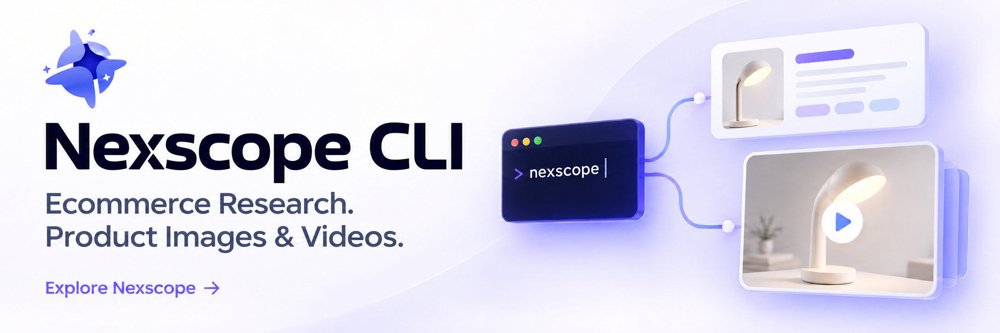

# Nexscope CLI

[](https://www.nexscope.ai/?co-from=githubCLI)

Discover Nexscope tools, inspect their input schemas, make explicit MCP calls,
and turn your own product data into comparison reports from the terminal.

Built for developers and ecommerce teams working with scripts, command-line
tools, and their own agent workflows.

## Get started in three steps

### 1. Install in terminal

macOS / Linux:

```sh
curl -fsSL https://raw.githubusercontent.com/nexscope-ai/nexscope-cli/main/install.sh | sh
```

Windows (PowerShell):

```powershell
irm https://raw.githubusercontent.com/nexscope-ai/nexscope-cli/main/install.ps1 | iex
```

This installs the standalone `nexscope` binary (no Python needed) after verifying its
SHA-256 checksum. On macOS and Linux, open a new terminal afterwards.

### 2. Sign in

Connect your Nexscope account. Your browser opens; the command finishes once you approve.

```sh
nexscope login
```

### 3. Search

Search Amazon. Online calls use credits, so they need explicit approval flags:

```sh
nexscope tools call nexscope_amazon_search keyword="portable blender" --execute --allow-paid --allow-write
```

Results and evidence are saved to a new folder. Replace `--execute --allow-paid --allow-write`
with `--dry-run` to preview the request for free. Explore all 565 tools with
`nexscope tools list --search tiktok`.

Installer options such as `--version` and `--prefix`: `curl -fsSL .../install.sh | sh -s -- --help`.
Standalone binaries are attached to releases from 0.1.2 onwards.

## Quick start with Python

With Python **3.11+**, you can instead install the published package in a virtual environment:

```sh
python -m venv .venv
# macOS / Linux
. .venv/bin/activate
python -m pip install --index-url https://pypi.org/simple nexscope-cli==0.1.2
nexscope --version
nexscope doctor --offline
nexscope tools list --search amazon
nexscope tools describe nexscope_amazon_search
```

On Windows PowerShell, use `py -3 -m venv .venv`, then
`.venv\Scripts\python.exe` and `.venv\Scripts\nexscope.exe` in place of
`python` and `nexscope`; activation is optional.

Create your first report using fictional sample data:

```sh
nexscope report demo --format json --out sample.json
nexscope report compare --input sample.json --format html --out comparison.html
```

Open `comparison.html` in your browser. Keep its sibling `.evidence` directory
with the report. For your own data, start with
`nexscope report template --format csv --out products.csv` and inspect
`nexscope report describe --schema`. Use new output filenames.

## What you can do

Use Nexscope CLI to support product selection, competitor research, keyword
planning, and ecommerce content creation. Start with local reports, or connect
to Nexscope to use the online tools available to your account.

### Ecommerce use cases

| Your task | How Nexscope CLI helps | Access |
| --- | --- | --- |
| Compare products for a shortlist | Turn your own CSV/JSON product data into HTML, CSV, or Markdown reports to review prices, ratings, and other supplied fields side by side | Free and offline |
| Research products and competitors | Inspect marketplace product-detail tools and retrieve available listing data for your research; the dedicated Amazon comparison workflow supports two or three ASINs | Online tools require authentication and applicable credits |
| Plan listing keywords and campaigns | Explore keyword expansion, search trends, and ASIN keyword tools to inform listing content and advertising research | Online tools require authentication and applicable credits |
| Create product images | Explore image-generation and product-marketing image tools for listing visuals, selling-point images, and campaign assets | Online creative services; model access and billing apply |
| Create product marketing videos | Use available video-generation tools with the required product references and inputs, then retrieve the generated result | Online creative services; model access and billing apply |
| Build your own research workflow | Use CLI commands in your scripts or agent workflows, inspect input schemas, and save results for subsequent analysis | Local preparation is free; online calls follow service access and billing rules |

The image and video rows describe online tools exposed through the generic
MCP `tools` command, not local media generation or a dedicated CLI video editor.
For asynchronous generation, submitting a request is only the first step;
inspect its status and use the corresponding result-retrieval tool.

Version **0.1.2** bundles a snapshot of **565 registered MCP tools** across
commerce research, advertising, SEO, patents, creative generation, result
retrieval, and workflow helpers. Live availability depends on the connected
server and account; catalog inclusion does not certify live acceptance.
See the [CLI tool guide](docs/full-tool-catalog.md) for discovery, schemas,
authentication, explicit execution, and result handling.

### CLI features

- **Discover:** search the bundled tool catalog and inspect input schemas offline.
- **Preview:** validate a proposed JSON request with `--dry-run` before execution.
- **Execute:** make one explicit MCP tool call and save its response and evidence.
- **Report:** export your own product data without an account, API key, LLM, or upload.

This CLI is distributed separately from the Nexscope Codex plugin and independent Skills.

## Discover and call tools

Search the bundled catalog, inspect a schema, and validate a proposed request
before connecting to the service:

```sh
nexscope tools list --search tiktok
nexscope tools describe nexscope_amazon_search
```

Save `{"keyword":"desk lamp"}` as `search.json`, then validate it locally:

```sh
nexscope tools call nexscope_amazon_search --input search.json --dry-run
```

For authentication, live calls, required effect flags, and catalog refresh,
follow the [complete tool guide](docs/full-tool-catalog.md). A generic execution
invokes one tool without automatic retries or page expansion. Asynchronous jobs
may require a separate result-retrieval call.

## Current scope

The bundled catalog supports discovery and input validation; it does not mean
every tool has passed live end-to-end acceptance. The dedicated Amazon comparison
workflow adapts search and product details. Successful live keyword search and
continuation remain outstanding acceptance gates. See
[ACCEPTANCE.md](ACCEPTANCE.md) for version-specific results.

The sections below retain detailed import rules, workflow behavior, connection
instructions, and development guidance.

## Install from source or a release wheel

From source on macOS or Linux:

```sh
git clone https://github.com/nexscope-ai/nexscope-cli.git
cd nexscope-cli
python3 -m venv .venv
. .venv/bin/activate
python -m pip wheel --no-deps --wheel-dir dist .
python -m pip install --no-index --no-deps dist/nexscope_cli-0.1.2-py3-none-any.whl
```

On Windows PowerShell, create the environment with `py -3 -m venv .venv` and use
`.venv\Scripts\python.exe` for the Python commands; activation is optional.
There is no need to change PowerShell's execution policy.

For an offline-only installation, a reviewed release wheel can be installed with
`python -m pip install --no-index --no-deps /absolute/path/nexscope_cli-0.1.2-py3-none-any.whl`.
The source installation above also skips runtime dependencies. Schema validation
and online operations require the declared dependencies; use the normal PyPI
installation for the complete CLI, or the hash-pinned profile under Connect.

## Import and report rules

Use fresh output names. Reports never overwrite files or silently fall back to
another directory. Keep each report with its sibling `.evidence` directory.
The samples are fictional. `nexscope demo product-comparison --out demo-output`
also exercises the complete three-product workflow without credentials or network.

`product_id` and `title` are required. A price requires an explicit currency;
a rating requires its explicit positive scale. Missing values stay unknown.
Identifiers must be strings and unique within a marketplace. Additional input
columns are retained as metadata. There is no inferred sales, profit, currency
conversion or ranking across different markets, currencies or rating scales.
Remote currency symbols such as `$` are ambiguous. The CLI keeps the product and
records `unresolvedCurrency`/`unresolvedPrice` alongside its raw evidence, while
leaving comparable currency and price unknown. It never infers USD from a symbol
or marketplace. Known fictional search candidates retain their fields in mock
details. Report dry-runs validate parent directories and existing outputs before
export. Successful live keyword search and continuation remain unaccepted; see
ACCEPTANCE.md for the exact results.

Raw UTF-8 CSV/JSON inputs are limited to 10 MiB and 10,000 products. Local imports
have no three-product limit. CSV errors use logical record numbers including the
header; JSON errors use one-based array positions. Invalid rows are explained,
never silently dropped. Versioned datasets allow 32 MiB because normalization
adds metadata; evidence bundles allow 64 MiB. See `report describe` for fields.

## Product comparison workflows

Remote planning is free of network and credential access:

```sh
nexscope workflow compare --asins B000000001,B000000002,B000000003 --dry-run
nexscope workflow compare --keyword lamp --dry-run
```

The bounded workflow accepts two or three distinct ASINs, or one search page
followed by explicit selection of two or three candidates. Use `--mock complete`
for fictional execution. `--mock partial` demonstrates partial completion.

```sh
nexscope workflow compare --keyword lamp --execute --mock complete --max-calls 4 --out candidates
nexscope workflow compare --resume candidates --select-asins B000000001,B000000002 --dry-run --mock complete
nexscope workflow compare --resume candidates --select-asins B000000001,B000000002 --execute --mock complete --format all --out finished
nexscope report compare --input finished/dataset.json --format markdown --out another.md
```

`--resume` imports the original search evidence, sends only the selected detail
requests and carries forward the original budget. One search plus two details
is three total requests. The original marketplace, source type, auth mode and
origin must agree; a resumed budget cannot increase. Omitted marketplace, auth
mode and max-calls inherit the checkpoint. `--keyword --select-asins` retains its
existing meaning of a new search plus details; use `--resume` after selection
to avoid paying for another search.

Only completed `CANDIDATES_READY` outputs with a valid manifest may be resumed.
Failed/incomplete outputs are never automatically replayed. A deliberate new
command using the same candidates starts another branch of work; there is no
server-side spending lock. `max-calls` is a request limit, not a monetary cap.
Ambiguous failures consume a call. No automatic retries, pagination or ASIN
expansion occur. Exit code 1 marks failures, partial or insufficient results;
inspect saved results and evidence before deciding what to do next.

Historical search imports are explicit user-selected evidence, not cache hits,
fresh live queries, proof of account identity or server-signed records. They are
never inserted into a credential context's cache. New requests use only the
currently selected credentials. Each finished directory contains the original
search plan/response, current plan, all details and hashes, with relative links.

`report compare` can read this version's `dataset.json` without refreshing data.
It checks the complete bundle, input digest, request contracts, product mappings,
selection and accounting, preserving `sourceType`, retrieval times, errors and
the original `inputName/inputSha256`. `report-input.json` separately identifies
the exact input selected for re-export. These hashes detect inconsistent edits
or corruption; they do not authenticate an author who can rewrite the whole
bundle. Do not treat third-party bundles as verified live market data.
Older preview datasets without manifests must be regenerated; this version does
not silently relabel them as user imports.

## Connect

Online browser/plugin use needs the existing hash-pinned dependency profile:
Set `APPROVED_API_ORIGIN` to the approved service origin. For paid data, set
`ASIN_1` and `ASIN_2` to verified real identifiers and explicitly approve the
request budget. The fictional identifiers used by mock examples are not live
test inputs; empty responses can still incur charges.

```sh
python -m pip install --require-hashes -r /absolute/checkout/cli/nexscope_cli/dependencies.lock
nexscope --api-base "$APPROVED_API_ORIGIN" auth login --source-client python-cli --source-channel github
# Complete the returned connection URL in your browser, then:
nexscope --api-base "$APPROVED_API_ORIGIN" auth poll
nexscope --api-base "$APPROVED_API_ORIGIN" account
nexscope --api-base "$APPROVED_API_ORIGIN" workflow compare --asins "$ASIN_1,$ASIN_2" --max-calls 2 --execute --allow-paid --out live-comparison
```

Browser credentials use the OS credential store. Supported backends are Windows
Credential Manager, macOS Keychain, Secret Service and KWallet. The CLI does not
read an environment key in `browser-account` mode or fall back when login fails.
`--api-base` is a global option before the command when a different approved
browser API origin is needed. Authenticated redirects are refused.

Independent Skills and explicit `--auth-mode env-api-key` use only
`NEXSCOPE_API_KEY` and `NEXSCOPE_PROXY_BASE`, privately configured in your shell.
They require no browser login or keyring. Do not put keys into command history,
documents or Git. Omit `--api-base` in this mode. Credential failure never
switches modes. Cache entries are valid-success-only, memory-only, expire after
300 seconds and are isolated by immutable auth context, origin, capability,
parameters, marketplace and contract. Separate processes never share a cache.

`get-skills`, browser-account `run ... -- <old script arguments>` and `export`
remain available. The bundled standalone scripts require exactly this wheel
version and preserve their JSON argument, `--inline`, `--no-cache`, original
environment configuration and legacy response/exit semantics. They forward a
legacy batch/page once without the bounded workflow's three-ASIN/one-page limits.
Legacy JSON business errors can still exit zero: inspect the response code/error.
Do not replace published Skills with these adapters before installation and live
compatibility acceptance. No dependencies are auto-installed at query time.

The comparison-specific adapter covers Amazon search/detail. Other registered
tools use the explicit MCP `tools` command. Credits are unknown (`null`); response
`cost` is not treated as a credit charge. Real account, balance and billing
acceptance remain separate gates. Reports contain no telemetry or automatic
upload. Review product data before sharing a report or its evidence.

## Development and verification

```sh
python -m pip install --no-deps .
python -m unittest discover -s tests -v
python scripts/check_resources.py
python -m pip wheel --no-deps --wheel-dir dist .
python scripts/verify_wheel.py dist/nexscope_cli-0.1.2-py3-none-any.whl
```

The standard-library test suite runs with no service credentials. The wheel
verification creates a fresh environment outside the checkout, clears source
path injection, installs the actual wheel without dependencies, blocks network
and keyring for offline checks, then runs the installed test suite and CLI cases.
It also tests old adapters against a fictional loopback server. Loopback fixtures
do not constitute live Nexscope acceptance. CI runs the same checks on Windows,
macOS and Linux with Python 3.11 and 3.12; a configured matrix is not a passing run.

Use a separate environment for upgrades and rollback. Install the prior exact
verified wheel, and restore any paired Skill directory to its matching version.
The verification script accepts `--previous-wheel /path/to/prior.whl` to exercise
upgrade/rollback while checking that user reports and test credential sentinels
survive. No public package, tag, release or plugin upload is made by these scripts.

On a machine with a real supported OS credential store, add `--with-os-keyring`
alongside `--with-dependencies` to test an isolated fictional credential. The
verifier checks write/read, upgrade/rollback and uninstall persistence, then
deletes only its own uniquely named entry. It does not log in to a service or
modify an existing account credential. A missing desktop credential store is
reported as a prerequisite failure; it never falls back to plaintext storage.

For an Ubuntu host without `ensurepip`, use `--pip-wheel /path/to/reviewed/pip.whl`
to bootstrap pip inside the fresh venv from an explicit trusted wheel, such as
Python's bundled ensurepip wheel. This does not install into the system Python.
Windows and Ubuntu WSL2 installation acceptance has been run locally; WSL2 does
not certify macOS or a Linux desktop credential store.

When intentionally changing a bundled adapter, run
`python scripts/check_resources.py --update` and review the catalog diff. This
updates current-file hashes only; historical source snapshot hashes are retained.
Keep CLI behavior here and have consumers pin its version; do not maintain a
second CLI copy in the published plugin.

See [ACCEPTANCE.md](ACCEPTANCE.md) for verified scope and outstanding release gates,
and [the macOS handoff](docs/HANDOFF-MACOS.md) for the remaining acceptance work.
Report reproducible problems, without keys or private reports, in
[GitHub Issues](https://github.com/nexscope-ai/nexscope-cli/issues). `nexscope-ai` is the
maintainer; operational ownership and real-user pilot gates are recorded separately
and must not be inferred from passing automated tests.

Apache-2.0. Initial source: plugin commit
`814f28016af6b3ff57ef12093a6bb133c4fb20b9`. Original Skill provenance remains in
the catalog. See `NOTICE`, `ASSET-NOTICES.md` and `THIRD-PARTY-NOTICES.md`.

## Free and paid usage

The CLI, local tool discovery, dry-runs, and offline reports are free.
Online data requests use credits, with pay-as-you-go Data Credits available
without a subscription. Online image and video generation follows the relevant
creative-service subscription, access, and credit rules; Data-only credits do
not cover creative generation. See [current pricing](https://www.nexscope.ai/pricing?co-from=githubCLI).

## Explore more with Nexscope

Find data, image, and video capabilities in the
[Nexscope API and MCP documentation](https://www.nexscope.ai/api-docs?co-from=githubCLI),
or [get an API key](https://www.nexscope.ai/seller/api-access?co-from=githubCLI)
to connect your workflows. Visit [Nexscope](https://www.nexscope.ai/?co-from=githubCLI)
for the broader platform.

If the CLI is useful, star this repository and explore more
[APIs, skills, and developer resources on GitHub](https://github.com/nexscope-ai).
